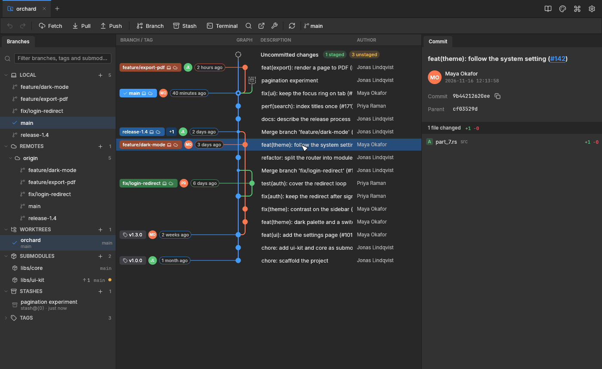
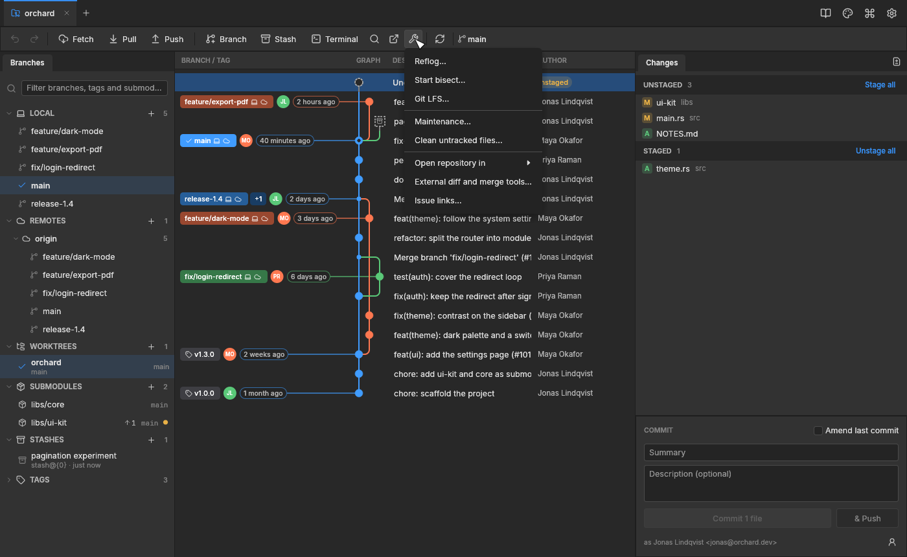
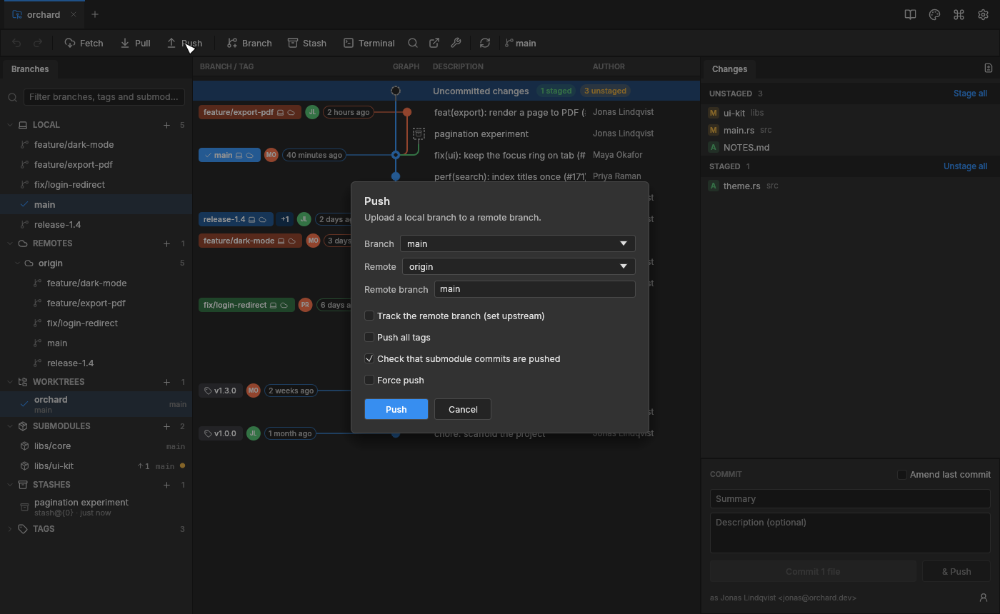

<p align="center"></p>
<h1 align="center">gitcrafted</h1>
<p align="center"><b>A visual git client that stays out of your way, and out of your data.</b></p>
<p align="center">
<a href="https://github.com/itowhid06/gitcrafted/releases"></a>


</p>

A simplified yet powerful take on the usual graph-based git GUIs, in Rust with
[egui/eframe](https://github.com/emilk/egui): it builds on Windows, Linux and macOS and stays light
and fast. It drives the installed `git` command line, so your config, credentials and hooks apply
as usual.

gitcrafted started as a fork of [gitcraft](https://github.com/Vancete/gitcraft) by Iván (Vancete)
and keeps everything it has. It adds submodules, option dialogs for fetch, pull, push, merge and
stash, patches, a reflog, bisect, Git LFS, maintenance tools, issue links and more, with a
test suite that drives real repositories to make sure none of it can lose your work.



| The Tools menu | Fetch, pull, push and merge ask for their options |
| :---: | :---: |
|  |  |

## What gitcrafted adds

- **Submodules** in the sidebar: branch or commit, ahead/behind, a dot when they moved; double-click
  to open one in its own tab.
- **Option dialogs** for fetch, pull, push, merge and stash, like the ones in dedicated git GUIs.
- **Force push with a lease** that a background fetch cannot defeat.
- **Patches**: save staged or unstaged files you picked, a stash or a commit; apply a patch with
  whitespace, `--index`, three-way and reverse options.
- **Edit any commit's message**, **Commit & Push**, **stash only some files**, and a checkout that
  local changes block offers to stash, switch and bring them back.
- **Tools**: reflog, bisect with a progress bar, Git LFS, maintenance, a previewed clean.
- **External diff and merge tools**, and **Open in** your editor or IDE.
- **Issue links** in commit messages.
- **Data safety** you can run: the tests snapshot everything a user could lose and assert it is
  still there.
- **A new name and logo**, and a Linux menu entry with the full icon set, so the dock, the top
  bar and the application menu show the right icon and name (see below).

## Features

**Repositories and tabs**

- Start page: checks that `git` is installed; open, create (`git init`) or clone a repository;
  recent repositories.
- Browser-like tabs, one per repository (Ctrl+T, Ctrl+W, middle-click; Ctrl+Shift+T reopens the
  one closed last). Open tabs, recents, theme and settings are remembered.
- Changes made elsewhere (editor, terminal) show up by themselves: the folder is watched.

**Graph**

- Every branch, coloured lanes, ↑/↓ to move. History loads 1500 commits at a time as you scroll.
- Branch and tag pills in their own column left of the graph, on each branch's tip only, joined
  to their commit: white text, a laptop icon when the branch is local, a cloud when a remote has
  it at that commit (`x` and `origin/x` make one pill), a pull-request icon when one is open,
  `+N` when more refs share the commit, the author's avatar and how long ago it was ("2 hours
  ago"). Author, date and hash columns are optional (Settings).
- The checked-out branch's pill is solid, the others a darker shade. Double-click a pill to
  check that branch (or tag) out; hover `+N` to list every pill of the commit and double-click
  the one you want.
- Double-click a pill further on than its branch (the remote's, say) to move the branch there,
  checking it out if needed: uncommitted changes are stashed and applied again on top (if they
  clash, the files are left with conflicts to fix and the stash is kept). When the two have
  diverged, the toolbar turns into the choices for a moment: rebase, merge or reset.
- Hide or solo branches: an eye on each branch in the left pane (on hover) hides it from the
  graph, with its own commits; _Solo_ in its menu draws only the soloed ones. The headers show
  how many are drawn (`4/5`), the toolbar says how many are hidden and shows them all again on a
  click. Kept per repository.
- Stashes in the graph, above the commit they were made on, marked with their icon.
- Each commit's summary, followed by the rest of its message, faded and cut to fit.
- An _Uncommitted changes_ row on top while the working tree is dirty.
- Search (Ctrl+F) through messages, authors and hashes of all history, or switch to _Code_ to
  find the commits that added or removed a piece of text in a file (`git log -S`); Enter /
  Shift+Enter jump between results, loading older history when needed.
- Right-click a commit of the checked-out branch to edit its message, move it up or down, or
  drop it, without going through the interactive rebase (Ctrl+Z undoes each).
- Right-click a commit: create a branch or a tag, check it out, edit its message, save it as a
  patch, start a bisect or mark it good / bad, interactive rebase onto it, cherry-pick, revert,
  reset the current branch to it (soft / mixed / hard, confirmed), the menu of each branch on it,
  copy the hash, message or branch name. Right-click a branch's pill to get check out,
  fast-forward, merge, rebase and interactive rebase for that branch on top.
- Issue references in a commit's message (`#123`, `ABC-123`, or your own prefix) are links to
  your tracker. GitHub and GitLab remotes need no setup; other trackers get rules in
  _Tools › Issue links_, kept in the repository's git config.
- Compare: Ctrl+click a second commit (or _Compare with…_ in the commit menu, the changes row
  standing for the working tree) to list the files that differ between the two and open each
  diff. On a branch, _Changes x adds to main_ shows only what it changed since the two diverged,
  as a pull request shows it, and _Compare main with x_ every difference; a checkbox switches
  between the two. The right pane says how many commits each side has that the other hasn't.
- Interactive rebase: the commits to rewrite, newest on top; pick, reword (edit the message in
  place), squash, fix up or drop each one, move them up and down, then _Start rebase_. Ctrl+Z
  undoes it.

**Branches, remotes, worktrees, submodules, stashes, tags** (left)

- Local branches with ahead/behind; right-click: check out (or in a new worktree), fast-forward,
  merge into / (interactively) rebase onto the current branch, push, force push (with a lease),
  create a pull request, rename, delete…
- The filter box above the branches has the usual right-click menu (cut, copy, paste, select
  all, clear).
- Remotes: add, edit (name and URL), fetch one, remove; their branches below each.
- Worktrees: add (existing or new branch), open in a tab, open a terminal there, lock, remove,
  prune.
- Submodules: listed with their checked-out branch or commit, ahead/behind and a dot when they
  moved or have changes. Double-click one to open it in its own tab. Right-click: initialize,
  update (to the recorded commit or the latest remote one), fetch, deinitialize, open a terminal
  there. The + adds one. Before an update would leave commits that are on no branch behind, you
  are asked first.
- Stashes: stash with a message, untracked files and keep-index options, or only the files you
  Ctrl+clicked; see what a stash holds, apply, pop, drop, save it as a patch.
- Pull / merge requests of GitHub (through `gh`) or GitLab (through `glab`): list, open in the
  browser, check out, create from a branch.
- Tags: create (light or annotated, optionally pushed), push, delete locally or on the remote.

**Fetch, pull, push, merge**

Each opens a small dialog with its options instead of acting at once.

- _Fetch_: one remote or all, prune deleted branches, skip tags, force.
- _Pull_: remote and branch, then fast-forward only, merge or rebase, with an optional
  auto-stash, skipping tags and updating submodules.
- _Push_: branch, remote and remote branch, set upstream, push tags, check that submodule commits
  are pushed, and force push. A force push uses a lease (`--force-with-lease` with
  `--force-if-includes`): git refuses when the remote has commits you haven't looked at, even if
  a background fetch has already downloaded them. A tick lets you override it.
- _Merge_: fast-forward when possible, always a merge commit or fast-forward only; squash;
  don't commit yet; a message.
- A checkout that local changes block offers _stash, switch and reapply_ (a conflicting reapply
  keeps the stash) or, behind a tick, discarding them.

**Changes and commits** (right)

- Conflicted / unstaged / staged lists with stage, unstage, discard and mark-resolved buttons,
  _Stage all_ / _Unstage all_; right-click a file to open it, open it in your editor, show it in
  its folder, see its history or blame, or ignore it (the file, its extension or its folder go
  into `.gitignore`; a tracked file stops being tracked).
- Part of a file: _Stage hunk_, _Discard hunk_ and _Unstage hunk_ on each hunk of its diff, or
  click the changed lines you want (Shift+click for a range) and stage, unstage or discard only
  those. Discarding can be undone with Ctrl+Z.
- Commit box (Ctrl+Enter; with nothing staged it stages everything), _Amend last commit_
  (warns when the commit is already pushed), _& Push_ to commit and push in one go, the identity
  you commit as, and saved identities to switch a repository to.
- Edit a commit's message: double-click it in the right pane or choose _Edit message…_ in its
  menu. The latest commit is amended; an older one on the checked-out branch is reworded by a
  rebase (refused while changes are staged, or when merges came after it).
- Patches: Ctrl+click files in the Changes lists to pick several, then right-click to save the
  picked (or all) staged or unstaged changes as a patch file; untracked, binary and non-UTF-8
  files included. A stash and a single commit can be saved as patches too (a merge commit as its
  diff against the first parent). The icon in the Changes header, or the command palette,
  applies a patch file: whitespace handling, stage it too, three-way merge, or in reverse.
- Open a changed file in your external diff tool, or a conflicted one in your merge tool.
- Undo / redo (Ctrl+Z / Ctrl+Y) of commits, amends, merges, rebases, pulls, resets,
  cherry-picks, reverts, checkouts, branch create / rename / delete, tags and stashes.

**Diffs and conflicts** (centre)

- Unified or side by side, syntax colours (bat's languages: TypeScript, Vue, TOML, Dockerfile…),
  the changed part of each line marked, whitespace changes optional, images shown before / after.
  Esc closes.
- Only the changes or the whole file, and side by side or unified, both kept for next time. A
  strip beside the scrollbar marks where the changes are; click it to jump there, or use the
  arrows (Alt+Up / Alt+Down) for the change before or after. Drag over the lines to select text,
  Ctrl+C or right-click to copy it.
- A commit's files as a list of paths or a tree of their folders (a switch above them).
- Code colours: four styles of gitcrafted's own (CodeCraft's), or any colour theme installed in
  VS Code (or Insiders, VSCodium) imported in Settings › Themes, which then colours the whole
  window as well.
- Double-click a line of a diff, or right-click it, to open the file in your editor at that line.
- Conflicts open in a three-pane editor: each conflict's two sides with _Ours_, _Theirs_ and
  _Both_ buttons, and the result below (editable). _Use mine_ / _Use theirs_ for a whole file.
- A merge, rebase, cherry-pick or revert stopped on conflicts shows a banner with _Abort_; the
  commit box finishes it (_Continue rebase_ during a rebase).
- File history (every commit that changed the file, following renames; click one for its diff)
  and blame (who last changed each line, newer changes marked brighter; click to go to the
  commit).

**Tools** (the wrench in the toolbar)

- _Reflog_: where HEAD has been and when; find a lost commit again, check it out or branch from
  it.
- _Bisect_: mark commits good or bad; a bar under the toolbar shows the commit under test, about
  how many steps are left, and Good / Bad / Skip / Stop. Uncommitted work is left alone and
  _Stop_ returns to your branch.
- _Git LFS_ (when installed): track and untrack patterns, fetch, pull, push, prune, lock, unlock,
  install it in the repository.
- _Maintenance_: gc, repack, verify, commit-graph, prune remote branches, expire the reflog (your
  stashes are kept) and an aggressive gc, the last two after a confirmation.
- _Clean untracked files_: shows what would go and deletes exactly that.
- _Open repository in_ the editors and IDEs found on your PATH (VS Code, Cursor, Zed, JetBrains,
  Sublime…); _External diff and merge tools_ sets the ones git starts for you (graphical tools
  only: a terminal tool can't be started without a terminal).
- _Issue links_: the rules that turn `#123`-style references into links.

**Safety**

gitcrafted drives your repository, so what could lose work is guarded and tested against real
repositories:

- Nothing that deletes or overwrites takes a name as a pattern: a file called `*.md` is that
  file, for stash, discard, clean, patches and submodule commands alike.
- _Clean_ deletes only what its preview listed; a failed patch changes nothing; saving a patch
  never touches the repository; an aborted merge or rebase restores the exact earlier state.
- A pushed commit can't be undone with a reset that would diverge your branch from the remote;
  undo refuses to overwrite edits made after the operation.
- Expiring the reflog keeps stashes; an update that would leave commits on no branch behind asks
  first; force push keeps the lease.
- The test suite (`cargo test`) opens real tabs on real temporary repositories and checks all of
  this, including that the files, index, refs, stashes and HEAD are exactly what they were.

**Toolbar, terminal, app**

- Undo, redo, Fetch, Pull and Push (with incoming / outgoing counts; each opens a dialog with its
  options), new branch, stash, terminal, search, open the folder (Explorer / Finder, your
  editor), the Tools menu (the wrench), refresh (F5).
- Background fetch every few minutes (Settings; 0 turns it off).
- HTTPS sign-in: when a remote wants a username and password (or token) and no credential helper
  provides them, a dialog asks and the operation runs again. They stay in memory for the tab;
  git's own credential helper, if there is one, stores them. Cloning asks the same way.
- Terminal panel with tabs: PowerShell, cmd, Git Bash, WSL… on Windows, your shells elsewhere, in a
  real pseudo-terminal (ConPTY on Windows) with colours, scrollback, mouse selection and copy
  (Ctrl+C with a selection, Ctrl+Shift+C or right-click).
- Command palette (Ctrl+P): every action and branch, fuzzy matched.
- Manual (F1, or the book in the title bar): what each part does and every keyboard shortcut.
- Avatars: on a GitHub repository, the authors' GitHub accounts (through `gh` when installed, else
  GitHub's API); on GitLab, the host's avatar API; elsewhere Gravatar (a hash of the email).
  Cached on disk; can be turned off.
- Settings: zoom (applied with a button), branch column width, graph columns, avatars,
  notifications, update check, code themes, background fetch, editor command, default shell and
  terminal font size, saved identities.
- On macOS and Linux, ssh's questions (a password, a key's passphrase, trusting a new host) come
  up in a dialog: gitcrafted is ssh's `SSH_ASKPASS`.
- Checks GitHub every 12 hours for a newer release and shows a pill to download it (can be turned
  off).
- Toasts, and a desktop notification when a long operation ends while the window is in the
  background.
- Themes: Dark, Medium Gray and Light, from PhotoCraft's Pro palettes.

## Download

Ready-made builds for Windows, Linux (x86-64) and macOS (Apple silicon and Intel) are on the
[releases page](https://github.com/itowhid06/gitcrafted/releases). Git must be installed.

- **Windows:** `gitcrafted-…-setup.exe` installs it for your user (no administrator rights), with a
  Start menu entry, an optional desktop icon, _Open in gitcrafted_ on folders and an uninstaller.
  The `.zip` is the same program without installing.
- **Linux:** `gitcrafted-….deb` (Debian, Ubuntu, Mint…) and `gitcrafted-….rpm` (Fedora, openSUSE…)
  install it with its applications menu entry, from the software centre or with
  `sudo apt install ./gitcrafted-….deb` / `sudo dnf install ./gitcrafted-….rpm`.
  `gitcrafted-….AppImage` runs on any distribution: make it executable (`chmod +x`) and run it.
  The `.tar.gz` holds the bare binary and a `.desktop` file.
- **Linux icons and the menu entry:** on Wayland (GNOME, KDE…) a window gets its icon and name
  only from an installed `.desktop` file, so a program that no package installed shows a generic
  icon in the dock and the top bar. The first time an AppImage or a binary you built runs,
  gitcrafted adds `gitcrafted.desktop` and its icons (16 to 512 px and a scalable one) to
  `~/.local/share`, and keeps the entry pointing at the file that is running. _Settings ›
  Applications menu_ removes it, and then it stays removed. The `.deb` and `.rpm` install the
  same entry system-wide.
- **macOS** (11 or later): open `gitcrafted-…-macos-universal.dmg` and drag gitcrafted to
  Applications; the `.zip` holds the same app. It isn't notarized by Apple, so the first time
  macOS refuses to open it: go to _System Settings › Privacy & Security_ and click _Open
  Anyway_, or run `xattr -dr com.apple.quarantine /Applications/gitcrafted.app`. git comes with
  the Xcode command line tools (`xcode-select --install`) or Homebrew.

A release is built by `.github/workflows/release.yml` whenever a `v*` tag is pushed
(`packaging/windows/gitcrafted.iss` for the installer, `packaging/linux/build-appimage.sh` for the
AppImage, `[package.metadata.deb]` / `[package.metadata.generate-rpm]` in `Cargo.toml` for the
packages, `packaging/macos/build-app.sh` for the universal app, its `.dmg` and `.zip`).

## Build and run

```bash
cargo run --release                   # start
cargo run --release -- path/to/repo   # open a repository directly
cargo test                            # unit tests and tests on real temporary repositories
```

Linux needs the usual eframe system packages (e.g. `libxkbcommon-dev`, `libgtk-3-dev` for the
file dialogs, `libdbus-1-dev` for notifications). Pull requests need the GitHub CLI (`gh`) or
GitLab CLI (`glab`), logged in.

### Looking at the UI headlessly

`examples/ui_shot.rs` drives the app without a window (egui_kittest) and saves PNGs:

```bash
cargo run --example ui_shot -- path/to/repo /tmp/shot click:500,266 shot key:Escape shot
```

Steps: `click:x,y`, `dclick:x,y`, `rclick:x,y`, `cclick:x,y` (with Ctrl / Cmd), `sclick:x,y`
(with Shift), `drag:x1,y1,x2,y2`, `hover:x,y`, `wheel:x,y,dy` (negative scrolls down), `leave`,
`open:path` (another repository in a new tab),
`key:Name`, `ckey:Name` (with Ctrl / Cmd), `type:text`, `wait:ms`, `shot`. The README screenshot
was made this way, on a demo repository.

## Layout

| File                     | Job                                                                                |
| ------------------------ | ---------------------------------------------------------------------------------- |
| `src/git.rs`             | `git` CLI wrapper and output parsing (refs, log, status, stashes, remotes, search) |
| `src/graph.rs`           | lane layout for the commit graph                                                   |
| `src/forge.rs`           | pull / merge requests through `gh` and `glab`                                      |
| `src/avatars.rs`         | avatars from GitHub, GitLab or Gravatar, cached on disk                            |
| `src/update.rs`          | new-release check                                                                  |
| `src/desktop_entry.rs`   | applications menu entry and icons for a binary or AppImage no package installed   |
| `src/shell_path.rs`      | on macOS, the login shell's PATH for the commands gitcrafted starts                  |
| `src/settings.rs`        | user settings and their form                                                       |
| `src/manual.rs`          | the manual (F1): features and keyboard shortcuts                                   |
| `src/theme.rs`           | colour tokens, fonts, egui style (PhotoCraft's Pro themes)                         |
| `src/icons.rs`           | embedded Lucide SVG icons, tinted                                                  |
| `src/terminal.rs`        | integrated terminal: pty, VT parsing (`vt100`), painting, keys, selection          |
| `src/repo/mod.rs`        | one repository tab: state, background git work, undo / redo, toolbar               |
| `src/repo/sidebar.rs`    | branches, remotes, worktrees, stashes, pull requests, tags                         |
| `src/repo/branch_filter.rs` | branches hidden from or soloed in the graph                                     |
| `src/repo/graph_view.rs` | commit graph, pills, search bar, commit menu                                       |
| `src/repo/detail.rs`     | commit / stash detail, changes and commit box                                      |
| `src/repo/diff.rs`       | diff loading, pairing and the diff view (unified, split, images)                   |
| `src/repo/highlight.rs`  | syntax colours (syntect, with bat's syntaxes from `two-face`)                      |
| `src/vscode/`            | VS Code's colour themes: finding them, and reading one for code and window         |
| `src/code_theme.rs`      | gitcrafted's code styles and the code theme in use                                   |
| `src/askpass.rs`         | ssh's questions shown in the window (`SSH_ASKPASS`)                                |
| `src/repo/conflict.rs`   | three-pane conflict editor                                                         |
| `src/repo/rebase.rs`     | interactive rebase editor and its todo list                                        |
| `src/repo/file_view.rs`  | a file's history and blame                                                         |
| `src/repo/dialogs.rs`    | branch, tag, remote, worktree, pull request and confirm dialogs                    |
| `src/repo/ext.rs`        | hook for dialogs that live in their own file, the Tools menu, Commit & Push        |
| `src/repo/sync.rs`       | fetch, pull and push dialogs                                                       |
| `src/repo/branch_ops.rs` | merge and stash dialogs, the blocked-checkout prompt                               |
| `src/repo/submodules.rs` | submodules: listing, the sidebar section, the menu                                 |
| `src/repo/patch.rs`      | save and apply patches, file selection                                             |
| `src/repo/rewrite.rs`    | force push confirmation, editing a commit's message                                |
| `src/repo/reflog.rs`     | the reflog dialog                                                                  |
| `src/repo/bisect.rs`     | bisect: the bar, the start dialog, the commit menu entries                         |
| `src/repo/lfs.rs`        | Git LFS dialog                                                                     |
| `src/repo/maintenance.rs`| maintenance tasks and the previewed clean                                          |
| `src/repo/external.rs`   | editors and IDEs, external diff and merge tools                                    |
| `src/repo/issues.rs`     | issue-link rules and the clickable message text                                    |
| `src/repo/test_support.rs`| test fixture: a real tab on real temporary repositories, and snapshots            |
| `tests/branding.rs`      | name, icons, packages and links stay consistent                                    |
| `assets/app-icon/`       | the logo (SVG), `render.py` and the icon sizes it renders                          |
| `src/repo/widgets.rs`    | shared painted widgets (panel headers, file rows, avatars, tabs)                   |
| `src/app.rs`             | window shell: tabs, start page, cloning, palette, settings, toasts                 |

Assets and their licences: [ATTRIBUTION.md](ATTRIBUTION.md).

## License

MIT OR Apache-2.0, at your option ([LICENSE-MIT](LICENSE-MIT), [LICENSE-APACHE](LICENSE-APACHE)).
Based on [gitcraft](https://github.com/Vancete/gitcraft) by Iván (Vancete), under the same terms;
the copyright notices in the licence files stay as they were.
